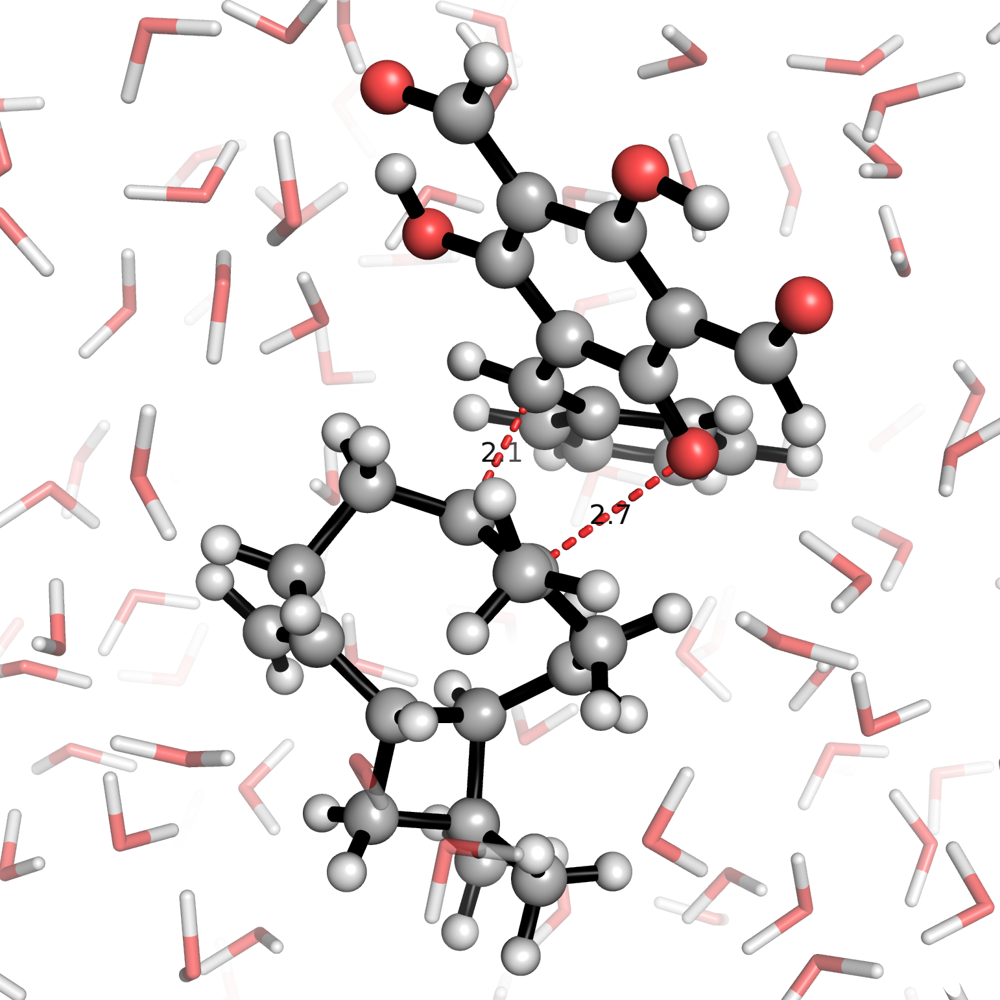

# react_ml_test_public

Tools and scripts for training / evaluating machine-learned interatomic potentials (MLIPs) for chemical reactions in vacuum and solution, as part of the pre-print: "Data-efficient fine-tuning for reaction modelling in explicit solvent" (Holownia, J.; Juraskova, V.; Deringer, V. L., Duarte, F., 2026): https://chemrxiv.org/doi/abs/10.26434/chemrxiv.15007217/v1.

An ORA repository of trained models, data, and other supplementary results can be accessed here: [ORA](https://ora.ox.ac.uk/objects/uuid:97dc4d30-24c1-473b-9379-86935fc54350). This contains data required to run the examples listed below. 

## Setup

1. Clone / fork this repository.
   
2. This repository has dependencies with [mlptrain](https://github.com/duartegroup/mlp-train). Clone `mlptrain` (WARNING: if your local machine does not have a GPU, you will need to modify the `environment_mace.yml` file by removing the last 3 lines for the pip cuequivariance dependencies before running the installation script). Then, run the `./install_mace.sh` script - this provides the conda environment named `mlptrain-mace`. 

    Then:
   
   ```bash
   conda activate mlptrain-mace
   pip install mace-torch==0.3.15
   pip install --upgrade ase
   ```

3. Install the current package into the environment (from the repository root: `react_ml_test/`). This provides the `rmlt` command used to run the workflow scripts (see [Running the scripts](#running-the-scripts)). An editable install is recommended while developing (run from within the `react_ml_test/` directory):
   
   ```bash
   pip install -e .
   ```

Notes:
- To run the ani-1nxr model, you must have the neurchem project in the parent directory of this repo. You must also then ensure you have the `libcublas.so.9.2` file (from CUDA 9.2) added to the `LD_LIBRARY_PATH`.
- For some features a specific fork of MACE is required (e.g. train loss logging + patience warmup, please let me know if you need these features!)

### Running with FairChem models

[FairChem](https://fair-chem.github.io) calculators (the `uma-*`, `esen-*` and `allscaip-*` models) can be used anywhere a model name is taken, but FairChem and MACE cannot be installed in the same env, so they must be run in their own conda env:

```bash
conda create -n fair_chem python=3.14 -c conda-forge
conda activate fair_chem
pip install fairchem-core
pip install -e .                    # once, from this repository: provides the `rmlt` command
hf auth login                       # login to hugging face, required to access UMA models after autorization (see https://github.com/facebookresearch/fairchem), will save an access token to your local machine
```

Name a model from `FAIRCHEM_MODELS` in `settings.py` (the names FairChem serves are listed there - models are fetched from FairChem's hub on first use and cached under `~/.cache/fairchem`) and provide relevant settings:

```yaml
model_names:
  - uma-s-1p2p1
fair_chem_task: "omol"        # FairChem only
fair_chem_setting: "turbo"    # FairChem only, optional ('turbo' is recommended for MD)
```

## Running scripts

Installing the package (see [Setup](#setup)) adds the `rmlt` command to your `PATH`. Scripts live in the `react_ml_test_public.scripts` package, and `rmlt` runs them by name from the repository root, for e.g.:

```bash
rmlt run-test-set-comparison <args>
```

The scripts read `data/`, `models/`, `inputs/` and write to `out/` relative to the current working directory, so they must be launched from the repository root. If you set up your own project and which to use the `rmlt` command, they can be run from a directory containing these folders in the same layout (with modifications required for the yaml inputs to specify where the `data`, `models`, and `out` subdirectories should be found).

List all available scripts with:

```bash
rmlt list
```

Scripts can also be run as ordinary modules, if you prefer:

```
python -m react_ml_test_public.scripts.run_test_set_comparison
```

### Submitting to a SLURM cluster

On a cluster, `rmlt slurm` queues a script through `sbatch` rather than running it here:

```bash
rmlt slurm run-mlip-md inputs/md/CPD_MVK_DA_dynamics_vac.yaml
```

The job is submitted with `slurm/slurm_script.sh`, a generic script that runs `rmlt` with the arguments it
is given. **The `#SBATCH` lines in that script are the job's resources** - partition, time, memory,
GPU and cluster - and they are meant to be edited by hand to suit the run. Please modify these to match your HPC system's specific submission architecture (assuming a SLURM workflow).

To see what would be submitted, and which resources the script asks for, without queueing anything:

```bash
rmlt slurm --dry-run run-mlip-md inputs/md/CPD_MVK_DA_dynamics_vac.yaml
```

Individual sbatch options can also be overridden for a single submission, which is convenient when
a run needs more time or a different partition than the script's header provides:

```bash
rmlt slurm --time=12:00:00 --partition=medium run-mlip-md inputs/md/CPD_MVK_DA_dynamics_vac.yaml
```

Submit from the repository root, as `slurm/slurm_script.sh` and the input YAML are both resolved relative to the working directory.

## Examples

Note: these examples will load precalculated .npz results to produce figures, as running the calculations requires the respective models (and a GPU is recommended). To run the examples below: .npz files of saved results in the ORA repository (`results/npz`) linked at the top of this file should be copied to replace `react_ml_test_public/out/npz`, and models from the ORA repository (`models/`) should be copied to replace `react_ml_test_public/models/`. If you wish to re-calculate results from scratch, clear all cache .npz files by running `rmlt clear-npz-cache` (or simply do not copy them in). 

### 1. Test set energy + force errors:


For zero-shot and fine-tuned models for CPD + MVK DA system:

Run: ```rmlt run-test-set-comparison inputs/test/CPD_MVK_DA_FT42_test.yaml```.

Output figures will be saved in `out/plt/bar_plots/`, and `out/csv/`, along with relevant values / statistics printed to the terminal.

This script reproduces the violin plot in Figure 3b\) in the paper, along with relevant supplementary bar plots.

To run this for the other two systems, use `inputs/test/anthracene_DA_FT46_test.yaml` and `inputs/test/guajadial_DA_FT50_test.yaml`.

### 2. IRC energy barrier:

 

For zero-shot and fine-tuned models for CPD + MVK DA system:

Run: ```rmlt run-reaction-barrier-comparison inputs/irc/CPD_MVK_DA_IRC_barrier.yaml```.

Output figures will be saved in `out/plt/irc/` and `out/csv/`, along with relevant values / statistics printed to the terminal.

This script reproduces Figure 3c\) in the paper, along with relevant supplementary plots.

To run this for the other systems, use `inputs/irc/anthracene_DA_IRC_barrier.yaml`, `inputs/irc/anthracene_1_4_DA_IRC_barrier.yaml`, and `inputs/irc/guajadial_DA_IRC_barrier.yaml`.

### 3. TS Optimisation + dynamics:

Image: Fine-tuned MACE-OFF TS optimisation in water of hetero Diels-Alder reaction to form guajadial.

 

#### 1. TS Optimisation

E.g. for fine-tuned model TS optimisation in vacuum and dynamics for CPD + MVK DA system:

First run: `rmlt run-mlip-ts-opt inputs/ts/CPD_MVK_DA_ts_opt_vac.yaml`.

Output optimised TSs, optimisation trajectories, logs and vibrational modes will be stored in `out/opt/`.

#### 2. Downhill dynamics

Then, run: `rmlt run-mlip-md inputs/md/CPD_MVK_DA_dynamics_vac.yaml`.

This will take the output optimised TS in vacuum from 1. and run 10 1ps dynamics runs, with the trajectories output to `out/trj/`.

Unlike the other example scripts, long MD runs are worth checkpointing: setting `save_md_checkpoints: true` in the input YAML writes a resumable checkpoint per run under `out/md_checkpoints`, every `checkpoint_every` ps (10 ps by default), holding the integration time step, the thermostat state, the step reached, the RNG state and the configuration - momenta included. Re-submitting the same input with `load_md_checkpoint: true` then carries every run on from its last checkpoint instead of starting it over, which is what a job that hit its SLURM time limit wants; the trajectory each run had already written is continued rather than replaced. Naming one checkpoint's path instead resumes just that run from it.

Each stretch of a run keeps its own benchmark CSV under `out/csv/md`, so a resume never overwrites the timings of the stretch before it: the first stretch writes `<trajectory name>.csv` and each one after it `<trajectory name>_contd_1.csv`, `_contd_2.csv` and so on, holding the steps that stretch took. They are refreshed every `checkpoint_every` ps rather than only at the end of a run, so a job that is killed still leaves the timings of the steps it managed.

#### 3. Analysis

To analyse the output trajectories, we then run:

`rmlt run-trajectory-analysis inputs/trj_analysis/CPD_MVK_DA_trj_analysis_vac.yaml`

Which will produce 2D trajectory plots like that in Figure 3d\) in `out/plt/trj_atom_dist/`, and print relevant RS / PS formation ratios.

The same process can be run but for solvent, using the relevant `in_solvent` yaml scripts (note that this can take some time). YAML inputs for the other two systems are also found in `inputs/`.

### 4. Pretraining bias analysis:

 

For the CPD + MVK DA system:

Run: `rmlt run-pretrain-bias-analysis inputs/pretrain_bias/CPD_MVK_DA_pretrain_bias.yaml`.

This will produce plots in `out/plt/descriptors` of the overall correlation scores, linear coefficients, and predicted error magnitudes across all models for each breakdown of the data.

This can be run for the other two systems using the provided yaml inputs: `inputs/pretrain_bias/anthracene_DA_pretrain_bias.yaml` and ``inputs/pretrain_bias/guajadial_DA_pretrain_bias.yaml`.

## Key Workflows

### 1. Dataset preparation (existing labelled xyz files)

#### 1. `rmlt save-npz-as-xyz`

#### 2. `rmlt add-xyz-metadata`

    - DESCRIPTION: Adds some xyz metadata to an .xyz file (= i.e. config type labels / box dimensions).
    - USAGE: Add relevant parameters in the python script and then run.

#### 3. `rmlt filter-datasets`

    - DESCRIPTION: Script to filter and / or combine .xyz file datasets.
    - USAGE: Add relevant parameters in the python script and then run, use this as in the other examples to first do force filtering, then filter by config type to create subsets.

#### 4. `rmlt save-train-test-split`

    - DESCRIPTION: Script to perform a train / valid / test split of an input dataset (or group of datasets) and save these as separate files.
    - USAGE: Combine all dataset subset sources (i.e. AL vac / solv + additional vacuum / solv configs) and split them into for e.g. a 70:10:20 train/valid/test split.
             Then use script in 3. to create train / valid / test vacuum / solvated subsets.

#### 5. `rmlt run-ds-analysis`

    - DESCRIPTION: analyse the spread of your dataset about a reaction coordinate, with SOAP descriptors, energy / force distributions etc.
    - USAGE: Run `rmlt run-ds-analysis inputs/dataset/guajadial_DA_train_subsets.yaml`, which analyses the datasets the YAML lists (their train / valid / test subsets here) against each other and writes the plots to `out/plt/ds_analysis/`. YAML inputs for the other two systems are in `inputs/dataset/`; set `filter_config_type: vacuum` (or `solvated`) in one to analyse only that half of the datasets, and `calc_soap: true` to add the SOAP-descriptor PCA plots (off by default, as it needs `dscribe` and takes a while for a whole dataset).

#### 6. `rmlt save-dft-inputs-from-xyz`

    - DESCRIPTION: Generate DFT (ORCA / VASP) single-point input files from an .xyz file of configurations (one input per config).
    - USAGE: Run `rmlt save-dft-inputs-from-xyz inputs/dft/guajadial_DA_test.yaml`, which writes the ORCA inputs to the `out_dir` the YAML sets (one subdirectory per config). YAML inputs for the other systems (and for VASP) are in `inputs/dft/`.

### 2. Analysis

- `rmlt run-test-set-comparison`. Runs the main energy / force comparisons of a selection of specified models. Precalculated results will be loaded from cached npz files.

## Package layout

```
react_ml_test_public/     # the installable Python package
├── helpers/              # library code (import react_ml_test_public.helpers.*)
└── scripts/              # workflow modules (run via `rmlt <name>`)
data/                     # runtime data (read relative to the working directory)
models/                   # store MLIP models here
inputs/                   # input YAML files for scripts
out/                      # runtime outputs stored here
testing/                  # some additional testing
slurm/                    # slurm submission scripts (`rmlt slurm <script> <input.yaml>`)
```

## Citation

If you use this code or dataset in your work, please cite:

```text
Holownia, J.; Juraskova, V.; Deringer, V. L.; Duarte, F. Data-Efficient Fine-Tuning for Reaction Modelling in Explicit Solvent. ChemRxiv 2026 (0810). https://doi.org/10.26434/chemrxiv.15007217/v1
```
