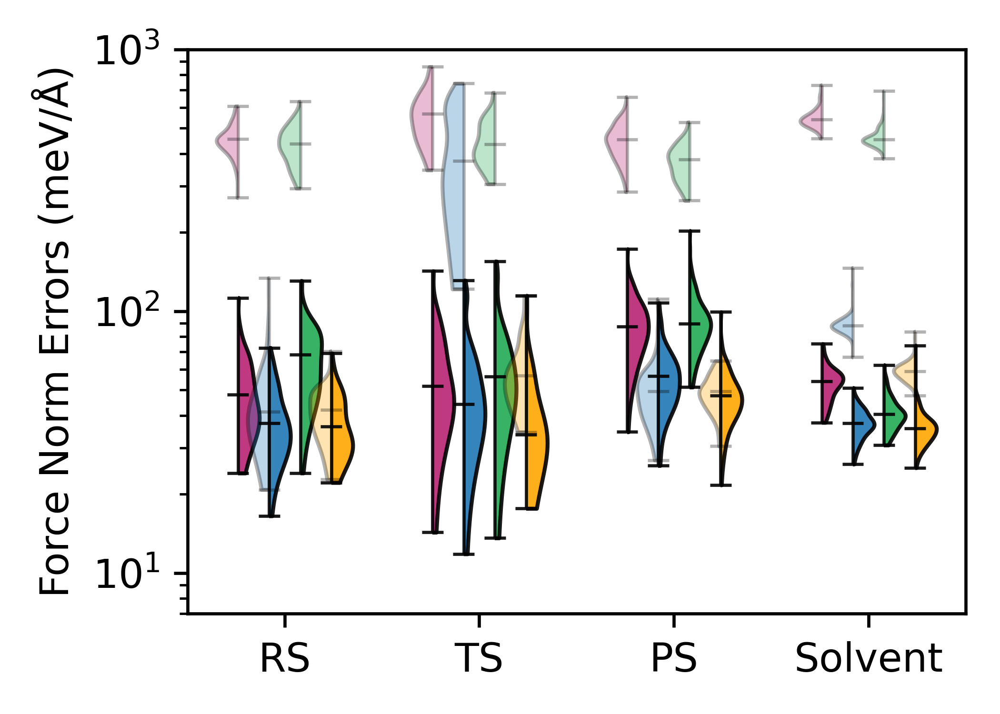
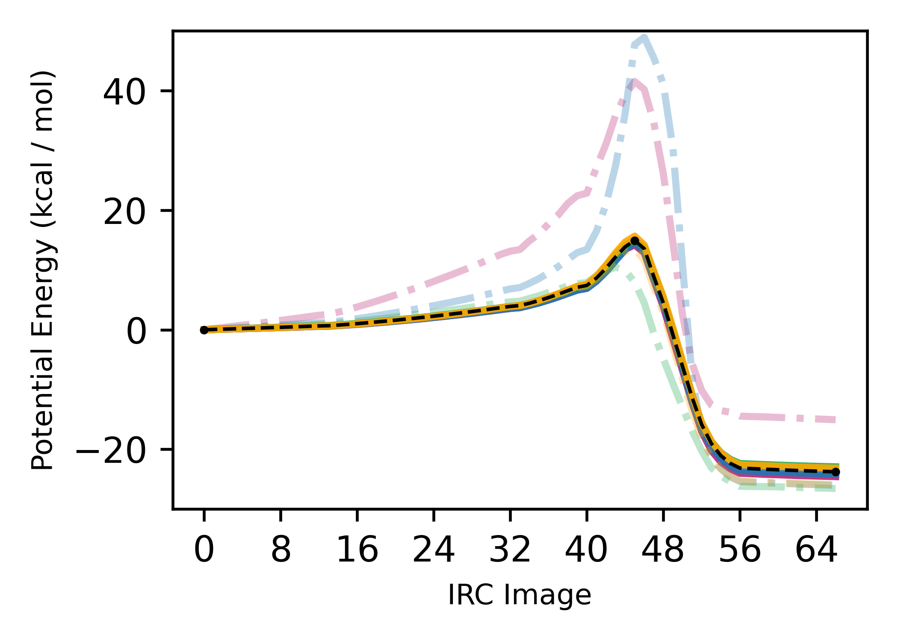
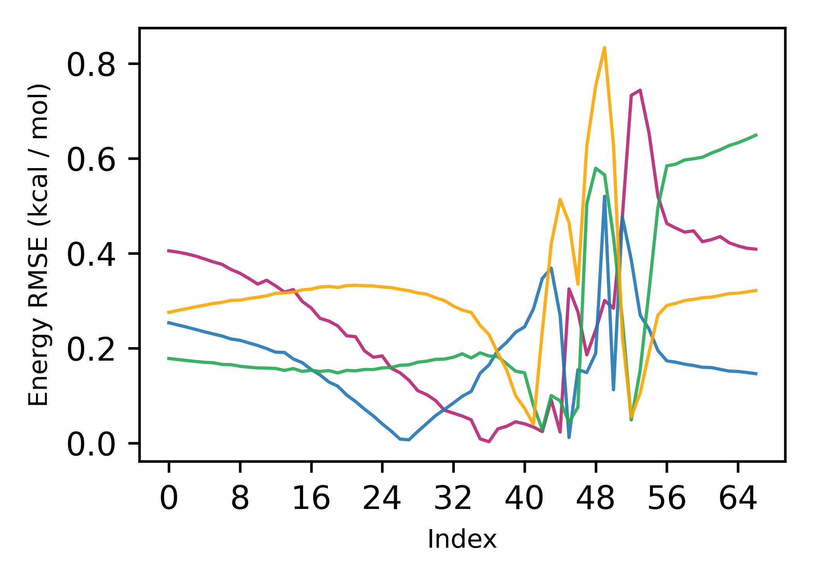
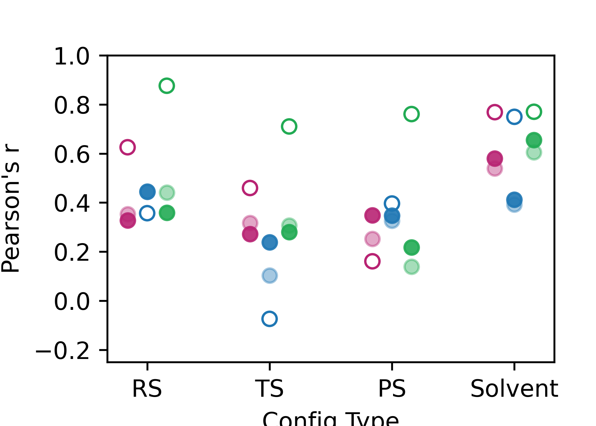
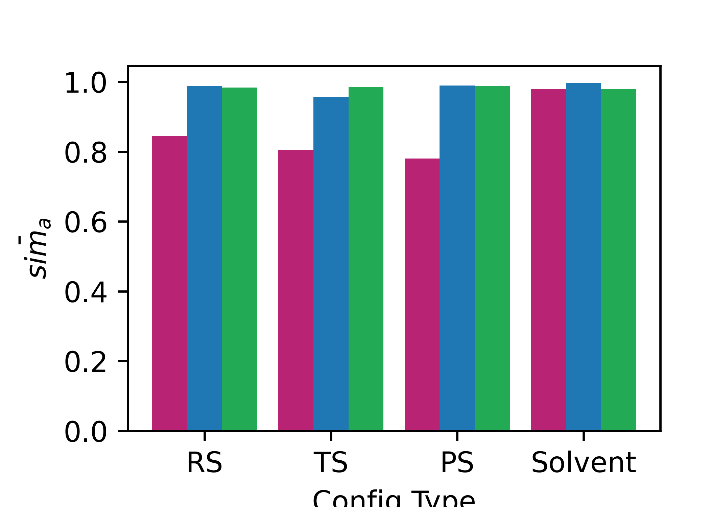

# react_ml_test_public

Tools and scripts for training / evaluating machine-learned interatomic potentials (MLIPs) for chemical reactions in vacuum and solution, as part of the pre-print: "Data-efficient fine-tuning for reaction modelling in explicit solvent" (Holownia, J.; Juraskova, V.; Deringer, V. L., Duarte, F., 2026): https://chemrxiv.org/doi/abs/10.26434/chemrxiv.15007217/v1.

An ORA repository of trained models, data, and other supplementary results can be accessed here: [ORA](https://ora.ox.ac.uk/objects/uuid:97dc4d30-24c1-473b-9379-86935fc54350).

## Setup

1. Clone / fork this repository.
   
2. This repository has dependencies with [mlptrain](https://github.com/duartegroup/mlp-train). Clone `mlptrain` and run the `./install_mace.sh` script - this provides the conda environment named `mlptrain-mace`. Then:
   
   ```bash
   conda activate mlptrain-mace
   pip install hdf5plugin
   pip install --upgrade mace-torch
   pip install --upgrade ase
   ```

3. Install this package into the environment. **This install is required** — it provides the
   `rmlt` command used to run the workflow scripts (see [Running the scripts](#running-the-scripts)). An editable install is recommended while developing:
   
   ```bash
   pip install -e .
   ```
   A regular install (`pip install .`) also works, but will ignore future code edits.

Notes:
- Run all scripts from the repository root directory. The scripts read `data/`, `models/`, `inputs/` and write to `out/` relative to the current working directory, so they must be launched from the repo root (or a directory containing these folders).
- Every YAML input that runs MLIP calculations takes a `cuda_device` field (default `"cuda:0"`). Set it to `"cpu"` to run on CPU, or to another GPU index (e.g. `"cuda:1"`) to pick a different card. If the requested device is not found on the machine — no GPU at all, or an index that does not exist — the scripts log a warning and fall back to `"cpu"` rather than failing. CPU runs also work on machines where CUDA is not visible to PyTorch at all: MACE models embed compiled e3nn submodules that e3nn reloads with a device-preserving `torch.jit.load`, so `load_model_calculator` injects the requested device into that call (`_jit_load_on_device` in `react_ml_test_public/helpers/io.py`).
- Only lightweight, PyPI-only dependencies are listed in `pyproject.toml`. The MLIP stack (MACE, mlptrain, autode, torchani, graph-pes, load-atoms, etc.) is installed via the `mlptrain-mace` environment.
- For some features a specific fork of MACE is required (e.g. train loss logging + patience warmup, please let me know if you need these features!)
- To run the ani-1nxr model, you must have the neurchem project in the parent directory of this repo. You must also then ensure you have the `libcublas.so.9.2` file (from CUDA 9.2) added to the `LD_LIBRARY_PATH`.

## Running scripts

Installing the package (see [Setup](#setup)) adds the `rmlt` command to your `PATH`.
Scripts live in the `react_ml_test_public.scripts` package, and `rmlt` runs them by name from the repository root, for e.g.:

```bash
rmlt run-test-set-comparison <args>
```

List all available scripts with:

```bash
rmlt list
```

Scripts can also be run as ordinary modules, if you prefer:

```
python -m react_ml_test_public.scripts.run_test_set_comparison
```

## Examples

Note: these examples will load precalculated .npz results to produce figures, as running the calculations requires the respective models (and a GPU is recommended, although each YAML's `cuda_device` can be set to `"cpu"`). To run the examples below: .npz files of saved results in the ORA repository (`results/npz`) linked at the top of this file should be copied to `react_ml_test_public/out/npz`, and models from the ORA repository (`models/`) should be copied to `react_ml_test_public/models/`. If you wish to re-calculate results from scratch, clear all cache .npz files by running `rmlt clear-npz-cache`. 

### 1. Test set energy + force errors:



For zero-shot and fine-tuned models for CPD + MVK DA system:

Run: ```rmlt run-test-set-comparison inputs/test/CPD_MVK_DA_FT42_test.yaml```.

Output figures will be saved in `out/plt/bar_plots/`, and `out/csv/`, along with relevant values / statistics printed to the terminal.

This script reproduces the violin plot in Figure 3b\) in the paper, along with relevant supplementary bar plots.

To run this for the other two systems, use `inputs/test/anthracene_DA_FT46_test.yaml` and `inputs/test/guajadial_DA_FT50_test.yaml`.

### 2. IRC energy barrier:

 

For zero-shot and fine-tuned models for CPD + MVK DA system:

Run: ```rmlt run-reaction-barrier-comparison inputs/irc/CPD_MVK_DA_IRC_barrier.yaml```.

Output figures will be saved in `out/plt/irc/` and `out/csv/`, along with relevant values / statistics printed to the terminal.

This script reproduces Figure 3c\) in the paper, along with relevant supplementary plots.

To run this for the other systems, use `inputs/irc/anthracene_DA_IRC_barrier.yaml`, `inputs/irc/anthracene_1_4_DA_IRC_barrier.yaml`, and `inputs/irc/guajadial_DA_IRC_barrier.yaml`.

### 3. TS Optimisation + dynamics:

E.g. for fine-tuned model TS optimisation in vacuum and dynamics for CPD + MVK DA system:

#### 1. TS Optimisation

First run: `rmlt run-mlip-ts-opt inputs/ts/CPD_MVK_DA_ts_opt_vac.yaml`.

Output optimised TSs, optimisation trajectories, logs and vibrational modes will be stored in `out/opt/`.

#### 2. Downhill dynamics

Then, run: `rmlt run-mlip-md inputs/md/CPD_MVK_DA_dynamics_vac.yaml`.

This will take the output optimised TS in vacuum from 1. and run 10 1ps dynamics runs, with the trajectories output to `out/trj/`.

#### 3. Analysis

To analyse the output trajectories, we then run:

`rmlt run-trajectory-analysis inputs/trj_analysis/CPD_MVK_DA_trj_analysis_vac.yaml`

Which will produce 2D trajectory plots like that in Figure 3d\) in `out/plt/trj_atom_dist/`, and print relevant RS / PS formation ratios.

The same process can be run but for solvent, using the relevant `in_solvent` yaml scripts (note that this can take some time).
YAML inputs for the other two systems are also found in `inputs/`.

### 4. Pretraining bias analysis:

 

For the CPD + MVK DA system:

Run: `rmlt run-pretrain-bias-analysis inputs/pretrain_bias/CPD_MVK_DA_pretrain_bias.yaml`.

This will produce plots in `out/plt/descriptors` of the overall correlation scores, linear coefficients, and predicted error magnitudes across all models for each breakdown of the data.

This can be run for the other two systems using the provided yaml inputs: `inputs/pretrain_bias/anthracene_DA_pretrain_bias.yaml` and ``inputs/pretrain_bias/guajadial_DA_pretrain_bias.yaml`.

## Key Workflows

### 1. Dataset preparation (existing labelled xyz files)

#### 1. `rmlt save-npz-as-xyz`

#### 2. `rmlt add-xyz-metadata`

    - DESCRIPTION: Adds some xyz metadata to an .xyz file (= i.e. config type labels / box dimensions).
    - USAGE: Add relevant parameters in the python script and then run.

#### 3. `rmlt filter-datasets`

    - DESCRIPTION: Script to filter and / or combine .xyz file datasets.
    - USAGE: Add relevant parameters in the python script and then run, use this as in the other examples to first do force filtering, then filter by config type to create subsets.

#### 4. `rmlt save-train-test-split`

    - DESCRIPTION: Script to perform a train / valid / test split of an input dataset (or group of datasets) and save these as separate files.
    - USAGE: Combine all dataset subset sources (i.e. AL vac / solv + additional vacuum / solv configs) and split them into for e.g. a 70:10:20 train/valid/test split.
             Then use script in 3. to create train / valid / test vacuum / solvated subsets.

#### 5. `rmlt run-ds-analysis`

    - DESCRIPTION: analyse the spread of your dataset about a reaction coordinate, with SOAP descriptors, energy / force distributions etc.

### 2. Analysis

- `rmlt run-test-set-comparison`
  - DESCRIPTION: Runs the main energy / force comparisons of a selection of specified models. Precalculated results will be loaded from cached npz files.
  - USAGE: Add relevant parameters in the python script and then run.

## Package layout

```
react_ml_test_public/     # the installable Python package
├── helpers/              # library code (import react_ml_test_public.helpers.*)
└── scripts/              # workflow modules (run via `rmlt <name>`)
data/                     # runtime data (read relative to the working directory)
models/                   # store MLIP models here
inputs/                   # input YAML files for scripts
out/                      # runtime outputs stored here
testing/                  # some additional testing
```
